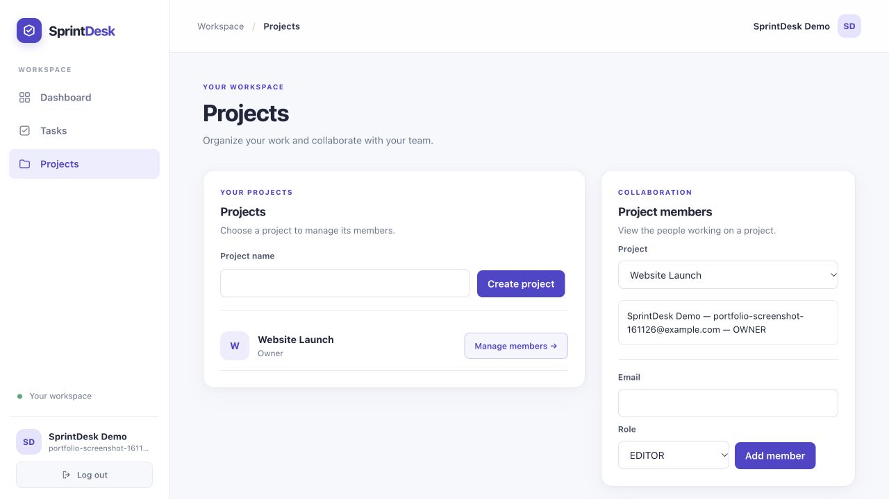
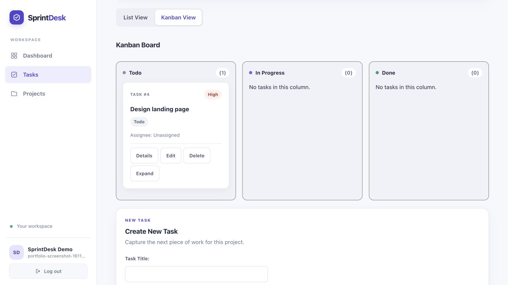

# SprintDesk

SprintDesk is a full-stack project management application for organizing collaborative work. It combines a Vue frontend, a NestJS API, and PostgreSQL, with role-based project access and task collaboration.

**Live demo:** [Open SprintDesk](https://web-production-5e9614d8.up.railway.app) · [Architecture](docs/architecture.md) · [Operations runbook](docs/operations/railway.md) · [Portfolio and interview notes](docs/portfolio.md)

Availability and free-tier capacity can vary. Choose **Create account** on the sign-in screen, register with a disposable email and password, then sign in. There is no published shared demo account. Use only disposable, non-sensitive data.

## Features

- Register, sign in, restore a session, and sign out through the UI.
- Create projects and manage registered members as owner, editor, or viewer.
- Create, assign, search, filter, edit, and delete tasks; switch between list and Kanban views.
- View task details and collaborate through comments. Viewers can comment; only the author can edit or delete their comments.
- Update comments optimistically with rollback on failure and protection against stale task/session responses.

Project permissions are enforced by the API; the UI also hides actions that are not available to the current role.

## Screenshots

Screenshots show a sample project and task using disposable demo data.

**Projects and members**



**Kanban task board**



## Tech stack and architecture

| Layer | Technologies |
| --- | --- |
| Frontend | Vue 3, TypeScript, Vite, Pinia, Vue Router |
| Backend | NestJS, TypeScript, Prisma 7 |
| Data | PostgreSQL |
| Delivery and tests | Docker, Caddy, Railway, GitHub Actions, Vitest, Supertest |

In the deployed topology, the browser reaches one HTTPS origin. Caddy serves the Vue build and forwards `/api/*` to the private NestJS service, stripping `/api`; Prisma connects the API to PostgreSQL. See the [architecture document](docs/architecture.md) for request paths and boundaries.

### Engineering decisions

- Passwords use Argon2id; opaque session tokens are stored as hashes, while the browser receives an HttpOnly cookie.
- Unsafe requests use an exact trusted-origin policy and session-bound CSRF tokens where applicable.
- Project roles are checked by the backend. Selected writes use a per-project database lock and recheck permissions inside the transaction to address membership races.
- Frontend request invalidation prevents old task/session responses from overwriting newer state. Comments use optimistic updates with rollback.
- Request logs use request IDs and route templates rather than request bodies or raw query strings.

## Local development

Prerequisites: Git, Node.js **24.19.0**, pnpm **10.34.5**, and PostgreSQL 16. Docker Compose is an optional way to run PostgreSQL. The API and web app are separate pnpm packages, each with its own lockfile; there is no root workspace install.

```sh
git clone https://github.com/ntee1993/sprintdesk.git
cd sprintdesk
pnpm --dir apps/api install --frozen-lockfile
pnpm --dir apps/web install --frozen-lockfile
cp apps/api/.env.example apps/api/.env
cp apps/web/.env.example apps/web/.env
```

Edit `apps/api/.env`: set `DATABASE_URL` to your local PostgreSQL database. If using the provided Compose file, also set `POSTGRES_PASSWORD` in that file and use the same password in `DATABASE_URL`; Compose creates the local database named `sprintdesk` with user `sprintdesk`. Choose your own local password and keep `.env` private. `apps/web/.env` can retain its development example.

To start PostgreSQL using the provided Compose file, with Docker already running:

```sh
docker compose --project-directory apps/api -f apps/api/compose.yaml up -d db
```

The Compose database binds to `127.0.0.1:5433` and persists in a Docker volume. Alternatively, use an existing PostgreSQL instance and configure `DATABASE_URL` accordingly. Do not point local development or test commands at production data.

Generate the Prisma client and apply the committed migrations to the configured **local** database:

```sh
pnpm --dir apps/api exec prisma generate --config prisma7.config.ts
pnpm --dir apps/api exec prisma migrate deploy --config prisma7.config.ts
```

Run the API and frontend in separate terminals:

```sh
pnpm --dir apps/api start:dev
pnpm --dir apps/web dev
```

By default, open `http://localhost:5173`; the API listens on port 3000. For configuration and deployment details, see [API environment examples](apps/api/.env.example), [web environment examples](apps/web/.env.example), and the [operations runbook](docs/operations/railway.md).

To create a local account, select **Create account** in the web UI. Enter a name, email and password of at least 12 characters; after registration, sign in with those credentials. The registration endpoint does not create a session.

### Environment variables

| Variable | Purpose |
| --- | --- |
| `DATABASE_URL` | Required API database connection; secret |
| `POSTGRES_PASSWORD` | Local Compose database password; secret |
| `PORT` | Optional API listening port |
| `CORS_ORIGIN` | Exact allowed browser origin; required in production |
| `NODE_ENV` | Controls production configuration and secure cookies |
| `AUTH_RATE_WINDOW_MS`, `AUTH_LOGIN_IP_LIMIT`, `AUTH_LOGIN_ACCOUNT_IP_LIMIT`, `AUTH_REGISTER_IP_LIMIT`, `AUTH_REGISTER_ACCOUNT_IP_LIMIT` | Optional per-instance authentication rate limits |
| `VITE_API_BASE_URL` | Public browser API base; production build requires `/api` |

Never put secrets in `VITE_` variables: they are exposed to browser code.

## Tests and checks

After installing dependencies and generating the Prisma client:

```sh
pnpm --dir apps/web test:unit
pnpm --dir apps/web lint:check
pnpm --dir apps/web type-check
VITE_API_BASE_URL=/api pnpm --dir apps/web build
pnpm --dir apps/api lint
pnpm --dir apps/api test
pnpm --dir apps/api test:e2e
pnpm --dir apps/api build
```

The API unit and mocked HTTP E2E suites do not establish PostgreSQL concurrency guarantees. The separate PostgreSQL integration suites require dedicated databases and safety-guarded connection settings. See the [CI workflow](.github/workflows/ci.yml) for the exact isolated database names, ports, migration step, and test commands. Never run those suites against development or production data.

## CI and deployment

GitHub Actions runs frontend and API checks and PostgreSQL-backed integration jobs on pull requests and pushes to `main`. The workflow does not itself deploy Railway. The web and API have Dockerfiles; Railway deployment and pre-deploy migrations are described in the [runbook](docs/operations/railway.md). Image validation, deployed browser behavior, and backup availability should be checked separately rather than inferred from CI.

## Known limitations and future work

- The in-memory authentication limiter is per API instance. Behind proxies, multiple users may share a socket-address bucket; a verified trusted-proxy design is needed before relying on client IPs.
- There is no published shared demo account; evaluators must register using disposable credentials.
- Task pages are fetched sequentially until the selected project's tasks are loaded. Project and comment lists are not paginated.
- `/health` reports API liveness, not PostgreSQL readiness. Backups and restoration must be verified for the chosen hosting plan.
- Browser CSP verification after deployment and Railway resource/credit limits require operational checks.

Potential next steps are to verify the proxy boundary and recovery procedure, add database readiness if needed, and measure real usage before changing pagination or indexes. See the [portfolio notes](docs/portfolio.md) for trade-offs and interview discussion points.
