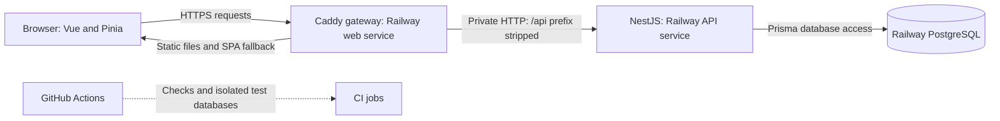

# Architecture

SprintDesk is a portfolio project with a Vue application, a NestJS API, and PostgreSQL. Its deployment uses the following same-origin request path:

The browser requests HTML and assets from Caddy. Vue sends same-origin requests under `/api`; Caddy's `handle_path` strips that prefix before proxying to the API over Railway's private network. The reverse arrow represents HTTP responses, not a separate deployment service. NestJS uses Prisma and its PostgreSQL adapter for database access.

## Authentication and authorization

Registration stores an Argon2id password hash. Login verifies credentials and creates a random opaque session token. The browser receives an HttpOnly cookie; PostgreSQL stores the token hash and expiry. Subsequent requests validate the server-side session; logout revokes it. Production cookies are `Secure` and `SameSite=Lax`.

Backend guards and services enforce project access. Owners manage memberships; owners and editors can mutate tasks; viewers can read tasks and participate in comments. Comment modifications require the author to retain project access. Task and comment writes use a project-row lock with permission checks inside the transaction to reduce membership-revocation races.

Unsafe requests require an exact trusted Origin or Referer. Authenticated mutations also use a session-bound CSRF token; login and registration are protected by the origin policy without requiring a pre-existing session. See [CSRF and deployment configuration](security/csrf.md) for details and limitations. The API uses in-memory authentication rate limits; behind proxies, the socket peer may not identify an individual user.

## Delivery and trade-offs

The web Docker image builds Vue and uses Caddy for static delivery and proxying. The API image builds NestJS and includes the Prisma configuration and migrations needed for a separate pre-deploy migration command. Railway hosts web, API, and PostgreSQL services; deployment configuration and recovery considerations are in the [runbook](operations/railway.md).

GitHub Actions runs lint, tests, builds, and isolated PostgreSQL integration jobs for pull requests and pushes to `main`. It does not itself deploy Railway or validate the deployed browser experience. Session and role checks favor explicit backend enforcement; project-level locking trades write concurrency within a project for simpler consistency. The app is intended for a small portfolio workload, not a demonstrated high-scale deployment.
